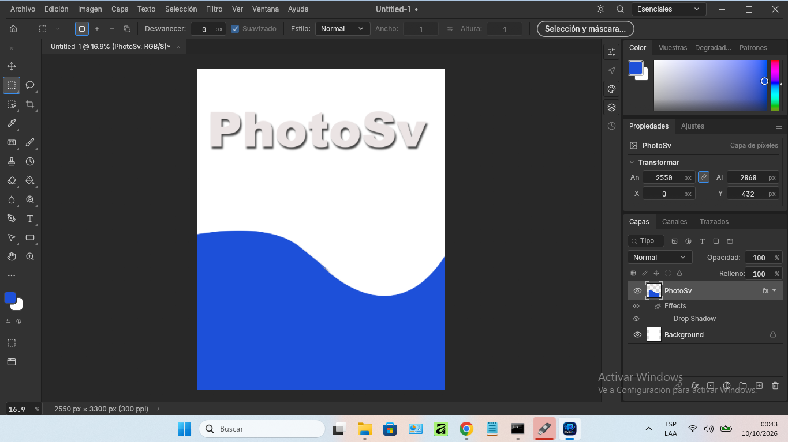

# PhotoSv

**PhotoSv** — open-source, native image editor for Windows and Linux (Photoshop-comparable).
Fast Rust + GPU core, custom title bar, layers, PSD support, CLI and automation API.

🌐 Website: https://agdala10.github.io/PhotoSv/



## Download

### Windows 10/11 x64

- **Portable + installer:** [PhotoSv-0.3.0-windows-x64-portable.zip](https://github.com/agdala10/PhotoSv/releases/download/v0.3.0/PhotoSv-0.3.0-windows-x64-portable.zip) (see [Releases](https://github.com/agdala10/PhotoSv/releases))
- Or grab `photosv.exe` directly from this repo.

### Linux x86_64 (Linux Mint, Ubuntu, Debian y derivados)

- **Paquete .deb** (instalación nativa: menú, iconos y asociación de PSD): [photosv-0.3.0-linux-x86_64.deb](https://github.com/agdala10/PhotoSv/releases/download/v0.3.0/photosv-0.3.0-linux-x86_64.deb) — 41 MB
- **AppImage** (portable, se ejecuta sin instalar nada): [photosv-0.3.0-linux-x86_64.AppImage](https://github.com/agdala10/PhotoSv/releases/download/v0.3.0/photosv-0.3.0-linux-x86_64.AppImage) — 38 MB

```sh
# .deb (Linux Mint, Ubuntu, Debian, Pop!_OS, elementary…)
sudo apt install ./photosv-0.3.0-linux-x86_64.deb

# AppImage (cualquier distro; no necesita FUSE)
chmod +x photosv-0.3.0-linux-x86_64.AppImage
./photosv-0.3.0-linux-x86_64.AppImage
```

Both ship `photosv-cli`, the headless converter and command runner. Needs glibc ≥ 2.35
(Ubuntu 22.04+, Debian 12+, Mint 21+); the `.deb` pulls its X11/Wayland and wgpu
dependencies by itself.

## Install

### Windows

1. Unzip the portable ZIP anywhere.
2. Run `install.cmd` → installs to `%LocalAppData%\Programs\PhotoSv` with Start Menu
   and Desktop shortcuts (no administrator rights needed).
3. Or run `photosv.exe` directly: with `portable.txt` next to it, settings stay in
   `PhotoSvData\` beside the exe (portable mode).

### Linux (Mint / Ubuntu / Debian y derivados)

1. Download the `.deb` and run `sudo apt install ./photosv-0.3.0-linux-x86_64.deb`.
   PhotoSv appears in the menu with its own icon; `.pcraft` opens with it.
2. Or use the AppImage: `chmod +x` it and double-click (no install, no admin).
3. `photosv` opens the editor, `photosv-cli` converts from the terminal.
4. Uninstall the package with `sudo apt remove photosv`.

## Contents

| File | What |
|---|---|
| `photosv.exe` | The app for Windows (v0.3.0, fixed: no black band at the window edges) |
| `PhotoSv-0.3.0-windows-x64-portable.zip` | App + `install.cmd` + portable mode + licenses |
| `install.cmd` | User-local installer (shortcuts, no admin) |
| `docs/` | Website sources (GitHub Pages) |

Linux builds (`photosv-0.3.0-linux-x86_64.deb`, `.AppImage`) live in the
[v0.3.0 release](https://github.com/agdala10/PhotoSv/releases/tag/v0.3.0).

## License

MIT / Apache-2.0. Powered by Agdala 2026 · agdala.sv@gmail.com
